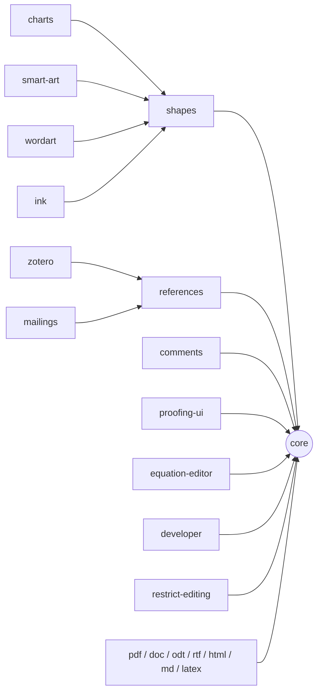

# WordCraft modularity: core and extensions

> **Last reviewed:** 2026-10-13 · **Last updated:** 2026-10-13 · **Change:** minor (Phase 2 done: extension hooks in `Session::run`; previously minor: Phase 1 done: owners, dependency scan, parity per extension; previously minor: Phase 1 first step; previously major: first version) · **Status:** Phase 2 done. Phase 3 is next.

This document is the plan for the modular edition of WordCraft. WordCraft becomes a small core plus
**extensions**. Each user selects the extensions they use. The default build contains every current
feature as an extension. A user can disable an extension at runtime, or build a binary without it.
When a feature needs another feature, WordCraft suggests that extension.

## 1. Verdict: the current structure is not sufficient

**The work is necessary (about 80% confidence).** The project has the correct seam for extensions,
but it has no mechanism to remove or disable a feature. The unknown: we did not measure the
binary-size gain of a minimal build (Phase 9 measures it).

What helps:

- **Everything is a command.** Each user-visible action is a `CommandSpec` with an id
  (`crates/engine/src/lib.rs:59`). The ribbon, shortcuts, the command search, the CLI, the control
  channel and MCP all dispatch by id through `Session::run`.
- **The commands are already grouped into 42 modules.** Each module has a `specs()` function
  (`crates/engine/src/cmd/*.rs`).
- **The knowledge graph shows a hub-and-spoke engine.** The command modules depend on the shared
  helpers in `cmd/mod.rs` and have few lateral links. The result helper `sel_result()`
  (`cmd/mod.rs:131`) connects 30 command communities. The `cmd/mod.rs` helpers are the de facto
  core API for extensions.
- **The layers are enforced.** `cargo xtask layers` (`xtask/src/layers.rs`) checks the dependency
  direction between crates.
- **Zotero is already a separate crate** (`crates/zotero`). It has a `Host` trait.
- **MCP lists the commands dynamically** from the registry (`crates/mcp/src/tools.rs:171`).

What blocks:

| # | Blocker | Evidence |
|---|---|---|
| B1 | No cargo features | No `[features]` in any `Cargo.toml`. No `cfg(feature)`. `engine` always depends on docx, docbin, pdf, formats, proof and render |
| B2 | One static registry | `cmd::registry()` (`cmd/mod.rs:58`) adds the specs of all 42 modules (~578 commands). `Session::new` always builds the full registry (`session.rs:581`) |
| B3 | Hard-wired feature hooks in `Session::run` | `session.rs:1119-1255` calls protect, macro recording, equation mode, moves, `column::dispatch`, fmt_revisions, connector reroute and `outline::after_command` by name |
| B4 | Core edit helpers call features | `delete_selection`, `insert_text` and `split_para_as` (`cmd/mod.rs:149-388`) call track changes and content controls |
| B5 | Feature state in core structs | `Session` holds merge, read-aloud, math, macros, versions, Quick Parts and bibliography state. `ViewState` holds draw and outline state. `Prefs` holds AutoCorrect and markup options |
| B6 | Module cycles and a catch-all | references ↔ citations ↔ index ↔ fields. `tools.rs` covers 12 id prefixes. Id prefixes do not match the modules (`protect` registers `review.restrict`) |
| B7 | Hand-coded ribbon | `crates/ui-egui/src/ribbon.rs` (2,568 lines) places ~340 buttons with literal ids. The tab list is fixed (`crates/engine/src/ribbon.rs:17`) |
| B8 | `ui.*` commands are not registered | `WordApp::ui_command` is a fixed match (`crates/ui-egui/src/lib.rs:948`). `WordApp` has fixed feature fields. The dialog dispatch is a fixed chain (`dialogs.rs:941`) |
| B9 | Hard-wired file formats | `crates/engine/src/io.rs:108-266` and `crates/formats/src/lib.rs:27` call each format by name |
| B10 | The UI imports engine internals | ui-egui imports `wordcraft_engine::cmd::<module>` from 33 modules |
| B11 | No in-process dynamic loading | `unsafe_code = "forbid"` stops `dlopen`. The wasm target must keep working |

The knowledge graph also shows that **features are vertical slices across crates**. Examples:
equations (doc model + OMML reader/writer + layout + equation tab), content controls (doc + docx
`sdt`), WordArt (engine + doc + layout) and restrict editing (engine + UI). An extension is
therefore a slice through several crates, not one crate.

## 2. Design principles

1. **The document model stays complete. Extensions own behaviour.** A minimal build must open,
   show and save a document that contains comments, equations or charts, with no data loss. The
   doc model, the DOCX round trip and layout stay in core. Extensions own the commands, UI, panes,
   state and heavy dependencies.
2. **An extension is a cargo feature.** There is one feature for each extension, and
   `default = ["full"]`. Large extensions move to their own crates (`crates/ext-*`) in Phase 8.
3. **Runtime enable and disable.** The registry contains only the enabled extensions. The global
   file `extensions.toml` (next to the preferences) keeps the choice. A per-document or
   per-project scope comes later.
4. **Dependencies are explicit.** Each extension has a manifest: `id`, `name`, `version`,
   `depends_on`, `provides`. If you enable an extension, WordCraft offers to enable its
   dependencies. If you disable one, WordCraft shows its dependents. If a document contains
   content for an extension that is missing, an info bar suggests that extension.
5. **"Install" means a build variant, not dynamic loading.** In-process plugins would need
   `unsafe` and would break wasm. Third-party extensions run **out of process** through the
   existing JSON control channel or MCP, by command id. WASM component plugins get a separate
   evaluation later.
6. **Track changes and content-control protection stay in core.** They are edit semantics inside
   the core helpers (B4). A split adds risk and saves little size.
7. **Everything stays a command.** The new configuration actions are commands too
   (`extensions.list`, `extensions.set`). The CLI, MCP and the control channel can then use them.
8. **Never crash.** A disabled or missing extension returns an error or a disabled reason. It
   never panics. `hostile_params_never_panic` must stay green for every build variant.

## 3. Extension cut (first version)

**Core (always present):** text, caret, edit, paste, para, styles, format, font, lists, tables,
page setup, view, file, options, find, outline view, fields, the display of footnotes and endnotes,
track changes, DOCX, layout, render, the proof crate (layout needs hyphenation).

| Extension | Contents (current modules) | Depends on | Heavy dependencies |
|---|---|---|---|
| `comments` | comment commands and pane (split from `review`) | core | – |
| `proofing-ui` | spelling, grammar, thesaurus commands (`review`, `options`) | core | – |
| `references` | TOC, captions, cross-references, index, citations, bibliography (`references`, `citations`, `index`) | core | – |
| `zotero` | Zotero bridge (`crates/zotero`, `ui-egui/src/zotero.rs`) | `references` | – |
| `equation-editor` | `equation`, `equation_tab.rs` | core | – |
| `charts` | `chart`, `dialogs_chart.rs` | `shapes` | – |
| `smart-art` | `smart_art`, `dialogs_smart_art.rs` | `shapes` | – |
| `wordart` | `wordart`, `wordart_menus.rs` | `shapes` | – |
| `shapes` | `objects`, `canvas`, `connectors` | core | – |
| `ink` | `draw`, `ink_shape`, `ink.rs` | `shapes` | – |
| `mailings` | `mailings` (mail merge, envelopes, labels) | `references` (fields) | – |
| `developer` | `controls` (content-control commands), `content_controls.rs` | core | – |
| `macros` | macro recording and playback (`tools`) | core | – |
| `compare` | compare, combine, versions (`tools`, `fmt_revisions`) | core | – |
| `read-aloud` | `speech` | core | – |
| `accessibility` | `accessibility`, `a11y_pane.rs` | core | – |
| `design` | `design` (themes, style sets) | core | – |
| `templates` | `templates`, `dialogs_templates.rs` | core | – |
| `restrict-editing` | `protect`, `dialogs_review.rs` (restrict pane) | core | – |
| `pdf-export` | PDF export (`crates/pdf`) | core | krilla |
| `pdf-import` | PDF reading (`crates/pdf`) | core | hayro |
| `doc-legacy` | Word 97-2003 import (`crates/docbin`) | core | cfb |
| `odt`, `rtf`, `html`, `md`, `latex` | one feature for each format (`crates/formats`) | core | quick-xml, zip |
| `automation` | MCP and the control channel (`crates/mcp`, app `control_server.rs`) | core | – |

Dependency graph:

The modules split across extensions (`review`, `tools`, `options`) are divided in Phase 1.

## 4. User experience

### File › Options › Extensions

A new pane in the backstage Options page. It uses the existing pane layout: add the id
`"extensions"` to `PANES` and to `pane_label` in `crates/ui-egui/src/options.rs:86`.

- Each row shows the extension name, version, scope (global; local later), dependencies and an
  **Enabled** toggle.
- Core rows show as always on, with no toggle.
- A row for an extension that this build does not contain shows **Not installed**, and tells the
  user which build variant contains it.
- The toggles run the commands `extensions.list` and `extensions.set {"id", "enabled"}`. The pane
  does not write the configuration file itself.
- If you disable an extension that others need, the pane lists the dependents and asks before it
  disables all of them. If you enable an extension, the pane asks to enable its dependencies.
- A change applies at once where possible. Otherwise it applies at the next start, and the pane
  tells the user which.
- A programmatic `extensions.set` never shows a prompt. It returns an error that names the
  missing dependencies, and accepts `"cascade": true`.

### Missing extensions

- A disabled command stays in the registry description with the disabled reason
  `"The <name> extension is disabled"`. Agents and the command search can then explain why.
- When a document contains content for a missing extension (for example an equation in a build
  without `equation-editor`), the document still shows and saves the content. An info bar offers
  to enable the extension, or tells which variant contains it.

### Build variants

- `wordcraft`: all extensions (the current behaviour).
- `wordcraft-minimal`: core only.
- Custom builds: `cargo build -p wordcraft --no-default-features --features "references,pdf-export"`.

## 5. Phased plan

Each phase builds, passes `cargo xtask ci`, and lands as its own commits. Each phase keeps the
`full` build identical in behaviour to today.

| Phase | Work | Result |
|---|---|---|
| 1 | **Descriptors, no behaviour change.** Add an `Extension` manifest type in engine. Tag every `CommandSpec` group with an extension id. Split `review`, `tools` and `options` along the extension cut. Add an xtask check: each command belongs to exactly one extension, and the dependency graph has no cycle. Report parity per extension | Every command has an owner |
| 2 | **Hook API.** Replace the hard-wired calls in `Session::run` (B3) with `before_run` and `after_run` hooks that extensions register | `Session::run` has no feature names |
| 3 | **State slots.** Move feature state out of `Session`, `ViewState` and `Prefs` (B5) into a per-extension store (`HashMap<&'static str, Box<dyn Any>>`, safe Rust) | Core structs have no feature fields |
| 4 | **Cargo features in engine.** One feature per extension, `full` as default. CI checks the minimal build, the full build and each feature alone | A minimal engine compiles |
| 5 | **Format registry.** An `Importer`/`Exporter` list in `io.rs` (B9). docbin, pdf and formats go behind features | Heavy format crates are optional |
| 6 | **UI contributions.** Extensions supply ribbon groups as data (B7). `ui.*` commands go into a UI registry (B8). Dialogs, panes and `WordApp` fields move to per-extension UI state. Imports from `engine::cmd::<module>` (B10) go through the extension API | The ribbon follows the enabled set |
| 7 | **Runtime enable and disable.** `extensions.toml`, `extensions.list` and `extensions.set`, the Options › Extensions pane, dependency prompts, the missing-extension info bar | Users manage extensions |
| 8 | **Extract crates.** Large extensions move to `crates/ext-*`. Add an extension layer between L4 and L6 to the `xtask layers` table | Extensions build and test alone |
| 9 | **Binaries.** Ship `wordcraft` and `wordcraft-minimal`. Measure binary size, start time and memory | Measured gain |
| 10 | **Later.** Local (per-project) scope. Third-party extensions out of process. A WASM plugin evaluation | Extension ecosystem |

### Risks

- **Round-trip loss in small builds.** Mitigation: principle 1. The doc model and DOCX I/O stay
  complete. Round-trip tests run on the minimal build.
- **Hidden coupling through string ids.** `outline` runs `para.*` commands, and `tools` runs
  `review.*` and `insert.*` commands by id. Mitigation: the Phase 1 xtask check also scans for
  calls by id that cross extensions without a declared dependency.
- **Feature-combination explosion in CI.** Mitigation: check minimal, full and each feature alone
  (not all combinations).
- **Parity floor.** The parity test applies to the full build. Minimal builds report parity and do
  not fail on it.

## 6. Sources

- Code exploration of the engine, UI, crates and apps, 2026-10-13.
- The graphify knowledge graph of the repository (12,609 nodes, 459 communities). The local
  output is in `graphify-out/` (not committed). The summary is in
  [modularity-graph-report.md](modularity-graph-report.md).

## Revision history

| Date | Change | Summary |
|---|---|---|
| 2026-10-14 | minor | Phase 2 done: `extensions::Hooks` (`before`, `verify`, `after_edit`) with `RunCtx`, kept in the `Registry` (`cmd::hooks()`). `Session::run` no longer names restrict editing, macro recording, the equation editor or connectors; those modules register hooks. Core steps (Repeat, undo, moves, column dispatch, formatting revisions, outline) stay inline |
| 2026-10-13 | minor | Phase 1 done: a test scans each command module for command-id literals that cross extensions without a declared dependency (`id_calls_respect_dependencies`, with `ALLOWED_CALLS` for name checks). `file.protect` moved to `restrict-editing`. `parity()` reports live features per extension. The `review`, `tools` and `options` files are not split yet; the owner overrides cover them until Phase 4 needs file boundaries for `cfg` |
| 2026-10-13 | minor | Phase 1, first step: `CommandSpec.ext`, `crates/engine/src/extensions.rs` (manifests, overrides, `dependents`), the owner shows in `list_commands`; tests check owners, dependencies and cycles. Module splits, the cross-extension id-call scan and per-extension parity remain |
| 2026-10-13 | major | First version: verdict, blockers, principles, extension cut, Options › Extensions pane, phased plan |
